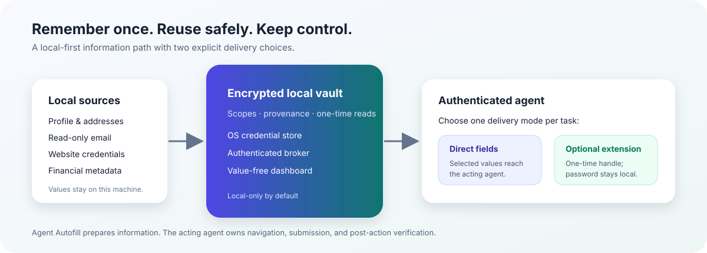
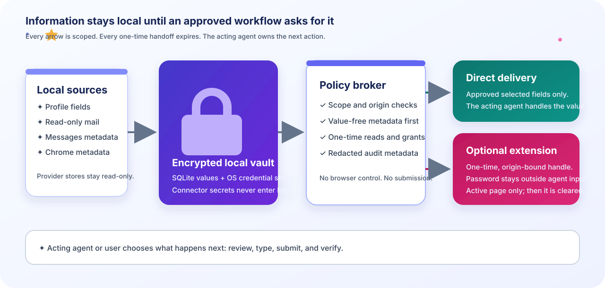

# Agent Autofill

<p align="center">
  
</p>

<p align="center">
  <strong>Your data. Your policy. Your agent.</strong><br>
  <em>Remember once. Reuse safely. Keep control.</em>
</p>

<p align="center">
  <a href="https://www.python.org/downloads/"></a>
  <a href="https://modelcontextprotocol.io/"></a>
  
  
  
</p>

<p align="center">
  <a href="docs/demo/index.html">Interactive demo</a> ·
  <a href="docs/gtm.md">GTM brief</a> ·
  <a href="#30-second-path">30-second path</a> ·
  <a href="#choose-your-delivery-mode">Delivery modes</a> ·
  <a href="docs/index.md">Docs hub</a> ·
  <a href="docs/agent-autofill.md">Operator guide</a>
</p>

Agent Autofill is a local-first information broker for agents. It keeps a
user's profile, read-only mail and Messages sources, website credentials, and
financial records in an encrypted local store, then returns only the
information an authenticated workflow asks for.

> **Platform:** macOS first. Linux and Windows support are coming soon.
> The current release uses macOS Keychain, Chrome, and Messages integrations.

The broker keeps the information and policy boundary local. The acting agent
may navigate and complete forms in its own browser surface, then must pause
for a fresh confirmation immediately before external submission. Financial
information always requires that confirmation.

> [!IMPORTANT]
> Agent Autofill keeps personal information local. Your acting agent can fill
> a form, but submission stays behind a fresh confirmation gate; financial
> information always requires it.

<table>
<tr>
<td width="25%"><strong>✦ Private memory</strong><br>Useful information stays on the user's machine.</td>
<td width="25%"><strong>✦ Selectable exposure</strong><br>Choose how much an agent receives for each workflow.</td>
<td width="25%"><strong>✦ Reviewable access</strong><br>See what is stored and which grants are active.</td>
<td width="25%"><strong>✦ Compounding usefulness</strong><br>Approved details make the next task easier.</td>
</tr>
</table>

## Watch the product tour

[](https://github.com/lifan-builds/agent-autofill/blob/main/docs/assets/agent-autofill-tour.mp4)

**Chrome remembers your details. Your agent can reuse the ones you approve.**
This illustrated tour uses synthetic data, AI narration, and original music. It shows the
intended agent-assisted workflow, not a recording of a live browser session.
[Watch or download the MP4](https://github.com/lifan-builds/agent-autofill/raw/refs/heads/main/docs/assets/agent-autofill-tour.mp4)
and read [what each scene means](docs/product-tour.md).

Agent Autofill stores records locally. Selected values returned to a cloud
agent enter that provider's context. The agent chooses relevant fields and
handles browser actions; the broker does not submit forms. Chrome intake needs
local execution, and inbox code retrieval needs a configured source.

## Project goals

| Goal | What it means in practice |
| --- | --- |
| **Keep personal data local and protected** | Store information locally, encrypt it at rest, keep connector secrets in the OS credential store, and let the user choose the access level: trusted local reads, narrow grants, direct selected fields, or an optional extension handoff. |
| **Make agents capable of finishing information-heavy work** | Give an authenticated agent the exact OTP, profile detail, or form-ready field it needs, with clear scope and provenance. The acting agent remains responsible for browser actions, submission, and any external acceptance check. |
| **Build useful memory over time** | Turn answers into organized, reusable profile, credential, and financial records. Matching starts with metadata, and new information becomes a reviewed proposal before it is encrypted and saved. |

The north-star slogan is simple:

> **Remember once. Reuse safely. Keep control.**

The three product promises behind it:

- **Private memory:** useful information stays on the user's machine.
- **Selectable exposure:** users choose how much an agent can receive for each workflow.
- **Compounding usefulness:** every approved detail makes the next task easier.

## At a glance

| Local-first | User-controlled | Agent-ready | Reviewable |
| --- | --- | --- | --- |
| Encrypted SQLite plus OS credential storage | Grants, origins, purposes, expiry, and revocation | Metadata matching, scoped reads, OTP support, and reusable records | Inbox dashboard, safe status commands, provenance, and audits |

## LLM-guided record matching

Forms do not need a hard-coded profile map. The acting agent sends only the
visible field metadata to `match_form_fields`, and Agent Autofill returns a
ranked, value-free table for the model to reason over:

| Step | What happens | Agent behavior |
| --- | --- | --- |
| **Rank** | Candidate records are scored by label meaning, Chrome field semantics, and any value-free learned mapping. | Try the first high-confidence row. |
| **Clarify** | Tied or missing rows include one focused `question`, such as which saved address to use. | Use page context first; ask the user only when it cannot make a safe choice. |
| **Remember** | After a confirmed choice or correction, `record_form_mapping_feedback` stores only field IDs, origin, purpose, and outcome. | The next table puts that choice first. |

The broker stays deterministic and local; the consuming LLM supplies the page
context and judgment. No profile value is sent merely to rank candidates, and
matching never approves the final external submission.

## The agent skill: three safe workflows

Agent Autofill gives an agent three clear ways to become more useful while
keeping the user in control. The agent chooses one path for each task; it does
not silently mix a read, a write, and a browser submission.

| Workflow | What the agent does | User control and boundary |
| --- | --- | --- |
| **1. Use saved data** | Read metadata first, match the smallest profile, credential, financial, email, or Messages record, then request only the fields needed for the current origin and purpose. | Values stay transient. Credential delivery is explicitly `direct` or `extension`; OTPs are one-time reads. The agent pauses for fresh confirmation before an external submit, purchase, account change, or consent. |
| **2. Propose new saved entries** | Turn a user-supplied or explicitly verified stable value into a complete add/update/no-op/held proposal with source context, sensitivity, scopes, confidence, and ambiguity. | Nothing is written until the user approves exact rows or a named batch. Passwords, full payment values, tokens, and OTPs never appear in proposals. |
| **3. Import from Chrome** | Read structured autofill names, contact details, and addresses from a user-selected local Chrome profile, keep source groups separate, and review the proposed changes. | Chrome reads are local and read-only. Saved-password import is a separate opt-in local sync; locked or unsupported databases stop without writes. |

For the agent instructions, start with the [three-part Agent Autofill skill](.agents/skills/agent-autofill/SKILL.md). For deeper workflows, use [form memory](.agents/skills/agent-autofill-form-memory/SKILL.md), [Chrome intake](.agents/skills/agent-autofill-chrome-intake/SKILL.md), and the [Chrome seed onboarding guide](docs/chrome-seed-onboarding.md).

### Missing fields become an optional memory step

When a form needs a field that is not saved, the acting agent asks once in the
context of the current origin and purpose:

> I need your company name for this job application. **Use once**, **save to
> Agent Autofill**, or **skip**?

The answer is used for the current form immediately. Once the user supplies a
stable value, the agent shows one compact confirmation card with the complete
proposal row (field id, category, display name, exact value, source,
sensitivity, saved-record scope (`any future authorized origin/purpose`),
current origin/purpose, confidence, and ambiguity) plus the exact narrow
`profile.write` scope when needed. The three actions are **use once**, **save
to Agent Autofill**, and **skip**. Choosing save is the single approval for both the
visible reusable record and the displayed narrow grant; the agent then obtains
that grant and writes the entry without a second proposal prompt. Future use
still requires the consuming workflow's own origin, purpose, and read-grant
checks.
Passwords, payment values, OTPs, tokens, handles, CAPTCHA answers, session
data, and inferred page values never enter this promotion path. Saving a field
also never approves the final browser submission.

## Install the command

From a checkout, install Agent Autofill as an isolated command-line tool:

```bash
uv tool install .
```

If you use `pipx`, the equivalent is:

```bash
pipx install .
```

Both commands install the declared runtime dependencies and put the
`agent-autofill` and `agent-autofill-server` commands on your `PATH`. Re-run
the same command with `--force` when you want to install a newer checkout.
For contributor development, an editable install is also available with
`python3 -m pip install -e .`.

For a no-install product tour, open the [interactive synthetic demo](docs/demo/index.html).
It does not read your files or make network requests.

## 30-second path

The shortest path from checkout to a safe, value-free inventory is four
commands. The optional setup step comes later, after you can see the local
surface.

```bash
agent-autofill --db ~/.agent-autofill.sqlite3 init
agent-autofill --db ~/.agent-autofill.sqlite3 quickstart
agent-autofill --db ~/.agent-autofill.sqlite3 inbox-web
```

`quickstart` is safe to rerun. It reports readiness, source health, counts,
and one next action without printing profile values, passwords, connector
secrets, tokens, or OTPs. `inbox-web` opens the loopback-only review page so a
new user can answer **What is stored?** and **What needs attention?** before
connecting an agent.

The dashboard is read-only. It is an inventory and access-review surface, not
a form-filling UI. Agents use the CLI/MCP path for matching, grants, OTPs, and
credential requests.

For guided import and connector setup, continue with:

```bash
agent-autofill --db ~/.agent-autofill.sqlite3 setup
agent-autofill --db ~/.agent-autofill.sqlite3 doctor
```

`setup` is interactive for identity and connector configuration. For a
review-first Chrome seed that can ask about ambiguous fields, use the [Chrome
seed onboarding guide](docs/chrome-seed-onboarding.md). `doctor` explains a
blocked Keychain, source, agent, or grant check and gives the next recovery
command. See the [first-run guide](docs/getting-started.md) for the expected
sequence and [troubleshooting](docs/troubleshooting.md) when a host permission
is missing.

> [!TIP]
> If you only want to inspect the product, run `quickstart` and `inbox-web`
> first. You can add profile fields, connectors, or credentials later.

If the CLI reports that the OS credential store is unavailable, unlock the
login Keychain and rerun `doctor` from a normal host process. Keep database
keys and connector secrets in the OS credential store; do not move them into
files, prompts, or environment variables.

## How the pieces fit

<p align="center">
  
</p>

```text
local sources  ->  encrypted broker  ->  authenticated agent
                      |       |
                  Inbox   optional extension
```

- **Broker:** validates scopes, redacts metadata, and owns one-time reads.
- **Inbox:** shows a value-free local inventory and access health.
- **MCP transport:** exposes the authenticated JSON-lines tool surface.
- **Optional extension:** consumes an origin-bound credential handle locally;
  the password stays out of the agent input.

Keychain-paired local services use their trusted local identity for read paths.
Older or remote clients can use explicit short-lived grants. Writes still use
the existing reviewed and authenticated paths.

## Choose your delivery mode in the CLI

Agent Autofill supports two explicit ways to handle a website credential. The
extension is optional; direct CLI delivery remains the canonical agent path.

| Mode | What crosses into agent input | Choose it when |
| --- | --- | --- |
| **Direct** | Only approved selected fields | The acting agent is allowed to handle the value and perform the next step. |
| **Optional extension bridge** | A short-lived, origin-bound handle; the password stays out of agent input | You want a lower-exposure local transport helper after the CLI grant is reviewed. |

Start with metadata-only matching. It returns site, username, field, and scope
information without returning a password:

```bash
agent-autofill --db ~/.agent-autofill.sqlite3 \
  credentials list --target-origin https://example.test
```

Create a value-free proposal for one site and choose the delivery mode before
the grant is written:

```bash
agent-autofill --db ~/.agent-autofill.sqlite3 \
  grant-site agent-1 https://example.test "account setup" \
  --delivery direct
```

Extension mode is optional. To use it, start the loopback bridge and load
`browser_extension/` as an unpacked Chrome extension:

```bash
agent-autofill --db ~/.agent-autofill.sqlite3 fill-server
```

The optional extension is a transport helper. It shows the active origin and
bridge state, consumes each handle once, fills the active page, and clears the
handle after the attempt. The acting agent owns navigation and submission, and
must apply the local confirmation policy immediately before submitting.

## Configure form submission confirmation

The default policy is `always`: the acting agent asks immediately before every
external form submission. A user may choose `non-financial` for ordinary forms,
but financial information always requires the confirmation gate:

```bash
agent-autofill --db ~/.agent-autofill.sqlite3 \
  policy form-submission --confirmation non-financial
agent-autofill --db ~/.agent-autofill.sqlite3 \
  policy form-submission --json
```

## See the security model

<p align="center">
  
</p>

The broker owns authorization and one-time reads. The inbox shows a value-free
inventory. The MCP transport exposes the authenticated local tool surface.
Connector secrets and the database key remain OS-store-backed.

## Email and other saved information

Use metadata first, then request only the exact information needed:

```bash
agent-autofill --db ~/.agent-autofill.sqlite3 \
  email-match owner@example.test

agent-autofill --db ~/.agent-autofill.sqlite3 \
  profile list --category identity --limit 20

agent-autofill --db ~/.agent-autofill.sqlite3 \
  financial-records --kind payment_card --last4 1234
```

Financial matching hints such as network, last four, and expiration identify a
record without returning its values. A later scoped read names the actual
stored field IDs the form needs, such as `card_number`,
`expiration_month`, or `billing_postal_code`.

Recipient-scoped OTP and verification-link reads require their own exact
operation and target context. A returned code or link is transient response
data; it is never written to audits or diagnostics. Agent Autofill returns the
information and stops there.

For a legacy or remote agent, an email OTP grant is explicit and short-lived:

```bash
agent-autofill --db ~/.agent-autofill.sqlite3 \
  grant-email codex email.otp owner@example.test --expires-in 600
```

The authenticated MCP surface exposes `search_messages`, `list_conversations`,
and `get_message` for read-only macOS Messages access. A message body or OTP
is returned only for the approved conversation scope and request; it is never
written to the audit trail.

## What the local vault can remember

The following is a synthetic example of the information a person might choose
to keep locally for repetitive forms. These values are illustrative only; do
not copy them into a real account.

| Record | Example stored data | What an agent can request |
| --- | --- | --- |
| **Identity** | `legal_name`: “Synthetic Demo User”; `preferred_name`; `date_of_birth`: `1990-04-12`; phone; primary and backup email | Only the named fields for one origin and purpose |
| **Home address** | `street`: “100 Demo Way”; `unit`: “4B”; `city`: “Example City”; `region`: “WA”; `postal_code`: `98101`; `country`: `US` | A selected address group or individual fields, with provenance |
| **Shipping address** | A separate reviewed address group for deliveries, including recipient name and delivery instructions | Only the shipping fields needed by the current form |
| **Preferences** | Organization, dietary preference, accessibility preference, and other stable form answers | Only the named preference fields; the agent must ask when a form needs something new |
| **Website credential** | `example.test` username plus an encrypted password and optional note | Direct selected fields, or a one-time origin-bound extension handoff that keeps the password out of agent input |
| **Payment card** | Synthetic “Travel Platinum” card; network; last four `4242`; expiration `05/2031`; card number and security code encrypted | Metadata matching first, then only approved financial fields for the checkout origin |
| **Email source** | A read-only IMAP/Gmail account such as `owner@example.test` | Search/read from the configured mailbox, or one recent mailbox-read OTP |
| **Text-message source** | Read-only macOS Messages conversations and sender metadata | Search/read within an approved conversation scope; a text-based code is transient response data, never a send or delete capability |

Listings and the Agent Inbox show metadata such as field IDs, groups, network,
last four, source health, provenance, and grant state. They do not show full
card numbers, security codes, passwords, mailbox tokens, message bodies, or
OTP values. Email has a dedicated `email.otp` operation using the
`mailbox-read` policy. Text
messages currently use the read-only Messages search/read path, so an agent
must have the correct conversation scope before it can inspect a text-based
code.

## Browser journeys that become practical

Agent Autofill is most useful when an agent can coordinate several narrow
requests around one browser task. The acting agent may navigate and prepare a
page using its own browser tools; Agent Autofill supplies only the approved
information. The user reviews the populated page and the acting agent asks
for a fresh confirmation immediately before submission.

### 1. Book a hotel without pasting a password or card number

1. The agent opens the hotel site and matches the saved credential by exact
   origin and username metadata.
2. The user approves “sign in to `hotel.example` for this booking” for ten
   minutes and chooses extension delivery.
3. The local bridge fills the current login page with a one-time,
   origin-bound handle; the password never enters the agent transcript.
4. The agent requests `legal_name`, travel dates, and the selected billing
   address fields for the same booking purpose.
5. If the hotel sends a sign-in code, the agent requests one recent,
   mailbox-read email OTP. If the code arrives by text, it reads only
   the approved Messages conversation.
6. The agent matches the selected payment card by network, last four, and
   expiration, then requests only the checkout fields required by the site.
7. The agent shows the guests, dates, price, and populated payment fields, then
   asks for the mandatory confirmation before submitting.

### 2. Complete a job-application profile while keeping identity fields scoped

1. The agent identifies the recruiting site and previews a request for name,
   phone, email, address, and birthdate.
2. The user approves only those fields for the named application origin and
   purpose; a different employer site gets its own read request and approval
   while reusing the same saved records.
3. The agent fills the profile, pauses on optional demographic questions, and
   asks the user instead of guessing.
4. The agent uses the saved recruiting-site credential through the extension
   handoff and retrieves a mailbox-read email OTP if the site requests one.
5. The agent reviews every answer with the user, asks for the immediate
   submission confirmation, and reports only evidence it can observe.

### 3. Recover access to a support portal using an email or text code

1. The agent matches the support portal credential without listing passwords.
2. The user approves the exact origin and “recover my account” purpose.
3. The agent requests one recent email OTP, or searches one approved Messages
   conversation if the provider sends the code by text.
4. The agent enters the code in the active page using its browser controls and
   stops at any password change, consent, or destructive action.
5. The user takes over for the final security decision and confirms the page
   result.

### 4. Check out on an online store without creating a standing grant

1. The agent previews the exact shipping address fields and matches a payment
   card by safe hints such as network and last four.
2. The user approves a short-lived checkout grant for the store origin.
3. The agent receives only the selected address and payment fields needed by
   the current checkout; unrelated household addresses and cards remain local.
4. The agent applies ordinary, user-chosen options and presents the final
   total, shipping method, and populated form.
5. The agent presents the total and payment fields, obtains the mandatory
   financial confirmation, then performs the purchase and reports evidence.

### 5. Register for an event using reusable profile memory

1. The agent requests a name, email, phone, organization, dietary preference,
   and accessibility preference as separate fields rather than receiving the
   whole profile.
2. The user approves the event origin and purpose, and declines any field that
   is unnecessary.
3. The agent fills the registration page, retrieves a one-time email code if
   required, and shows the completed answers.
4. The user reviews the answers, then the agent asks for a fresh confirmation
   immediately before submitting while the grant expires or is revoked after
   the task.

### 6. Recover smoothly when a form asks for something new

1. The agent matches saved identity and contact metadata and notices that the
   site also requires a company name that is not stored.
2. It asks for the company name once and offers **use once**, **save to Agent
   Autofill**, or **skip** rather than interrupting the whole task.
3. The agent shows one compact card with the exact value, field metadata,
   source, sensitivity, reusable saved-record scope, current form
   origin/purpose, confidence, ambiguity, and the narrow `profile.write` scope
   if it is needed. The user chooses **save to Agent Autofill** once; this approves
   the reusable record and grant together.
4. The agent obtains that grant, calls `write_records`, and continues with the
   value already supplied. It does not ask a second generic proposal-approval
   question, and the record can match later forms at other sites when the user
   authorizes those reads.
5. The completed page still stops at the normal submission gate. The save
   approval does not authorize account creation, payment, or any other submit.

These journeys make the agent feel end to end because it can discover the
right record, request a narrow grant, retrieve a recent mailbox-read code, use
the active browser page, and recover from a missing or
expired permission. The
broker still stops at the information handoff; the acting agent owns the
browser action and the confirmation gate keeps external side effects visible.

## Local storage and imports

- SQLite values are encrypted with a key held by the operating-system
  credential store.
- IMAP and OAuth connector secrets stay in that credential store.
- Chrome imports use read-only snapshots and explicit review before writing.
- Chrome Password Manager imports are a separate local-only opt-in and support
  encrypted v10/v11 records on macOS; unsupported v20/App-Bound Encryption and
  passkeys stop safely.
- Payment-card add/edit uses hidden prompts and masked metadata previews.

Provider databases and mailboxes are read-only. The normal setup and import
flows use the existing encrypted store without a schema migration.

## Documentation map

Start with the [docs hub](docs/index.md), or jump directly to the guide that
matches the job:

| I want to… | Read |
| --- | --- |
| Install and complete my first safe run | [Getting started](docs/getting-started.md) |
| Seed autofill and optionally saved passwords from Chrome | [Chrome seed onboarding](docs/chrome-seed-onboarding.md) |
| Understand direct versus extension delivery | [Access modes](docs/access-modes.md) |
| Find the right command | [CLI cookbook](docs/cli.md) |
| Recover from Keychain, Chrome, or bridge issues | [Troubleshooting](docs/troubleshooting.md) |
| Understand the implementation boundary | [Architecture and operator guide](docs/agent-autofill.md) |
| Evaluate the market and launch sequence | [GTM and competitive brief](docs/gtm.md) |
| Check platform and feature coverage | [Support matrix](docs/support-matrix.md) |
| Add code safely | [Package guide](agent_autofill/README.md) |
| Use the optional Chrome extension | [Extension guide](browser_extension/README.md) |
| Run form-filling scenarios | [Evaluation set](evals/form_filling/README.md) |

The longer [operator guide](docs/agent-autofill.md) keeps detailed connector,
grant, and MCP reference material in one place.

## Release and security

This is an early macOS-first preview. Read the [support matrix](docs/support-matrix.md)
before integrating, and use [SECURITY.md](SECURITY.md) for responsible
vulnerability reports. The code is released under [Apache-2.0](LICENSE).

## Development

```bash
PYTHONPATH=. pytest -q
ruff check agent_autofill tests/agent_autofill
mypy agent_autofill
python3 -m compileall -q agent_autofill tests/agent_autofill
git diff --check
```

The three agent-facing workflows also have a synthetic cross-layer smoke test:

```bash
PYTHONPATH=. pytest -q tests/agent_autofill/test_workflows_e2e.py
```

It covers metadata-first saved-data reads, direct and extension credential
delivery, safe financial matching followed by selected field reads, target-
bound email and Messages access, reviewed record writes, and Chrome intake
with cancellation plus partial approval. It uses temporary/in-memory data and
never opens the user's vault, Keychain, browser profile, mailbox, or Messages
database.

The repository targets Python 3.11 or newer. The package metadata in
`pyproject.toml` is the source of truth for runtime dependencies. Install the
project with `uv tool install .`, `pipx install .`, or an editable
`python3 -m pip install -e .` checkout. Use synthetic values in tests and
documentation. Never place real passwords, mailbox tokens, OTPs, payment
values, or one-time handles in fixtures, logs, screenshots, or review
artifacts.

<p align="center">
  <strong>✦ Remember once. Reuse safely. Keep control. ✦</strong><br>
  If this project helps your local agent work, consider starring it and sharing
  a safe evaluation case.
</p>
