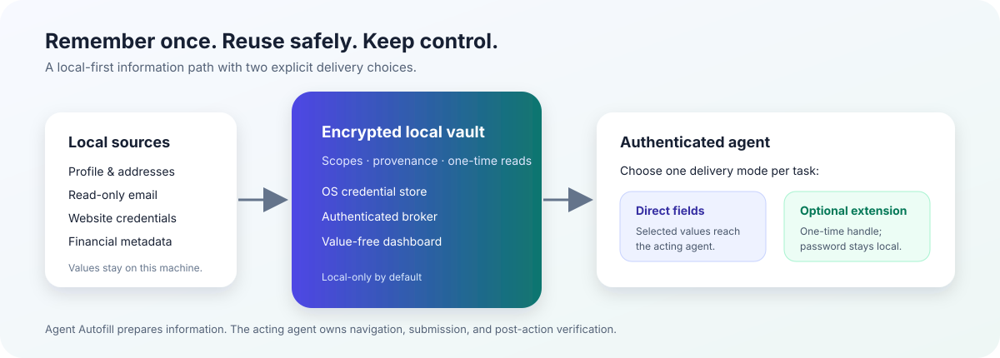

# Agent Autofill

<p align="center">
  
</p>

<p align="center">
  <strong>Your data. Your policy. Your agent.</strong><br>
  <em>Remember once. Reuse safely. Keep control.</em>
</p>

<p align="center">
  <a href="https://www.python.org/downloads/"></a>
  <a href="https://modelcontextprotocol.io/"></a>
  
  
</p>

<p align="center">
  <a href="#30-second-path">30-second path</a> ·
  <a href="#choose-your-delivery-mode">Delivery modes</a> ·
  <a href="docs/index.md">Docs hub</a> ·
  <a href="docs/agent-autofill.md">Operator guide</a>
</p>

Agent Autofill is a local-first information broker for agents. It keeps a
user's profile, read-only mail and Messages sources, website credentials, and
financial records in an encrypted local store, then returns only the
information an authenticated workflow asks for.

The product has one firm boundary: it prepares information; the acting agent
or user decides what to do with it. Agent Autofill does not navigate browsers,
submit forms, send or delete messages, or verify whether an external site
accepted an action.

> [!IMPORTANT]
> Agent Autofill prepares information. The acting agent or user decides what
> to do with it. It does not navigate browsers, submit forms, send or delete
> messages, or verify whether an external site accepted an action.

<table>
<tr>
<td width="25%"><strong>✦ Private memory</strong><br>Useful information stays on the user's machine.</td>
<td width="25%"><strong>✦ Selectable exposure</strong><br>Choose how much an agent receives for each workflow.</td>
<td width="25%"><strong>✦ Reviewable access</strong><br>See what is stored and which grants are active.</td>
<td width="25%"><strong>✦ Compounding usefulness</strong><br>Approved details make the next task easier.</td>
</tr>
</table>

## Project goals

| Goal | What it means in practice |
| --- | --- |
| **Keep personal data local and protected** | Store information locally, encrypt it at rest, keep connector secrets in the OS credential store, and let the user choose the access level: trusted local reads, narrow grants, direct selected fields, or an optional extension handoff. |
| **Make agents capable of finishing information-heavy work** | Give an authenticated agent the exact OTP, profile detail, or form-ready field it needs, with clear scope and provenance. The acting agent remains responsible for browser actions, submission, and any external acceptance check. |
| **Build useful memory over time** | Turn answers into organized, reusable profile, credential, and financial records. Matching starts with metadata, and new information becomes a reviewed proposal before it is encrypted and saved. |

The north-star slogan is simple:

> **Remember once. Reuse safely. Keep control.**

The three product promises behind it:

- **Private memory:** useful information stays on the user's machine.
- **Selectable exposure:** users choose how much an agent can receive for each workflow.
- **Compounding usefulness:** every approved detail makes the next task easier.

## At a glance

| Local-first | User-controlled | Agent-ready | Reviewable |
| --- | --- | --- | --- |
| Encrypted SQLite plus OS credential storage | Grants, origins, purposes, expiry, and revocation | Metadata matching, scoped reads, OTP support, and reusable records | Inbox dashboard, safe status commands, provenance, and audits |

## Install the command

From a checkout, install Agent Autofill as an isolated command-line tool:

```bash
uv tool install .
```

If you use `pipx`, the equivalent is:

```bash
pipx install .
```

Both commands install the declared runtime dependencies and put the
`agent-autofill` and `agent-autofill-server` commands on your `PATH`. Re-run
the same command with `--force` when you want to install a newer checkout.
For contributor development, an editable install is also available with
`python3 -m pip install -e .`.

## 30-second path

The shortest path from checkout to a safe, value-free inventory is four
commands. The optional setup step comes later, after you can see the local
surface.

```bash
agent-autofill --db ~/.agent-autofill.sqlite3 init
agent-autofill --db ~/.agent-autofill.sqlite3 quickstart
agent-autofill --db ~/.agent-autofill.sqlite3 inbox-web
```

`quickstart` is safe to rerun. It reports readiness, source health, counts,
and one next action without printing profile values, passwords, connector
secrets, tokens, or OTPs. `inbox-web` opens the loopback-only review page so a
new user can answer **What is stored?** and **What needs attention?** before
connecting an agent.

The dashboard is read-only. It is an inventory and access-review surface, not
a form-filling UI. Agents use the CLI/MCP path for matching, grants, OTPs, and
credential requests.

For guided import and connector setup, continue with:

```bash
agent-autofill --db ~/.agent-autofill.sqlite3 setup
agent-autofill --db ~/.agent-autofill.sqlite3 doctor
```

`setup` is interactive and review-first. `doctor` explains a blocked Keychain,
source, agent, or grant check and gives the next recovery command. See the
[first-run guide](docs/getting-started.md) for the expected sequence and
[troubleshooting](docs/troubleshooting.md) when a host permission is missing.

> [!TIP]
> If you only want to inspect the product, run `quickstart` and `inbox-web`
> first. You can add profile fields, connectors, or credentials later.

If the CLI reports that the OS credential store is unavailable, unlock the
login Keychain and rerun `doctor` from a normal host process. Keep database
keys and connector secrets in the OS credential store; do not move them into
files, prompts, or environment variables.

## How the pieces fit

<p align="center">
  
</p>

```text
local sources  ->  encrypted broker  ->  authenticated agent
                      |       |
                  Inbox   optional extension
```

- **Broker:** validates scopes, redacts metadata, and owns one-time reads.
- **Inbox:** shows a value-free local inventory and access health.
- **MCP transport:** exposes the authenticated JSON-lines tool surface.
- **Optional extension:** consumes an origin-bound credential handle locally;
  the password stays out of the agent input.

Keychain-paired local services use their trusted local identity for read paths.
Older or remote clients can use explicit short-lived grants. Writes still use
the existing reviewed and authenticated paths.

## Choose your delivery mode in the CLI

Agent Autofill supports two explicit ways to handle a website credential. The
extension is optional; direct CLI delivery remains the canonical agent path.

| Mode | What crosses into agent input | Choose it when |
| --- | --- | --- |
| **Direct** | Only approved selected fields | The acting agent is allowed to handle the value and perform the next step. |
| **Optional extension bridge** | A short-lived, origin-bound handle; the password stays out of agent input | You want a lower-exposure local transport helper after the CLI grant is reviewed. |

Start with metadata-only matching. It returns site, username, field, and scope
information without returning a password:

```bash
agent-autofill --db ~/.agent-autofill.sqlite3 \
  credentials list --target-origin https://example.test
```

Create a value-free proposal for one site and choose the delivery mode before
the grant is written:

```bash
agent-autofill --db ~/.agent-autofill.sqlite3 \
  grant-site agent-1 https://example.test "account setup" \
  --delivery direct
```

Extension mode is optional. To use it, start the loopback bridge and load
`browser_extension/` as an unpacked Chrome extension:

```bash
agent-autofill --db ~/.agent-autofill.sqlite3 fill-server
```

The optional extension is a transport helper. It shows the active origin and
bridge state, consumes each handle once, fills the active page, and clears the
handle after the attempt. It never navigates, clicks, submits, or reports site
acceptance. The acting agent requests information through the CLI/MCP path and
owns the next action and post-action verification.

## See the security model

<p align="center">
  
</p>

The broker owns authorization and one-time reads. The inbox shows a value-free
inventory. The MCP transport exposes the authenticated local tool surface.
Connector secrets and the database key remain OS-store-backed.

## Email and other saved information

Use metadata first, then request only the exact information needed:

```bash
agent-autofill --db ~/.agent-autofill.sqlite3 \
  email-match owner@example.test

agent-autofill --db ~/.agent-autofill.sqlite3 \
  profile list --category identity --limit 20

agent-autofill --db ~/.agent-autofill.sqlite3 \
  financial-records --kind payment_card --last4 1234
```

Recipient-scoped OTP and verification-link reads require their own exact
operation and target context. A returned code or link is transient response
data; it is never written to audits or diagnostics. Agent Autofill returns the
information and stops there.

## Local storage and imports

- SQLite values are encrypted with a key held by the operating-system
  credential store.
- IMAP and OAuth connector secrets stay in that credential store.
- Chrome imports use read-only snapshots and explicit review before writing.
- Chrome Password Manager imports support encrypted v10/v11 records on macOS;
  unsupported v20/App-Bound Encryption and passkeys stop safely.
- Payment-card add/edit uses hidden prompts and masked metadata previews.

Provider databases and mailboxes are read-only. The normal setup and import
flows use the existing encrypted store without a schema migration.

## Documentation map

Start with the [docs hub](docs/index.md), or jump directly to the guide that
matches the job:

| I want to… | Read |
| --- | --- |
| Install and complete my first safe run | [Getting started](docs/getting-started.md) |
| Understand direct versus extension delivery | [Access modes](docs/access-modes.md) |
| Find the right command | [CLI cookbook](docs/cli.md) |
| Recover from Keychain, Chrome, or bridge issues | [Troubleshooting](docs/troubleshooting.md) |
| Understand the implementation boundary | [Architecture and operator guide](docs/agent-autofill.md) |
| Add code safely | [Package guide](agent_autofill/README.md) |
| Use the optional Chrome extension | [Extension guide](browser_extension/README.md) |
| Run form-filling scenarios | [Evaluation set](evals/form_filling/README.md) |

The longer [operator guide](docs/agent-autofill.md) keeps detailed connector,
grant, and MCP reference material in one place.

## Development

```bash
PYTHONPATH=. pytest -q
ruff check agent_autofill tests/agent_autofill
mypy agent_autofill
python3 -m compileall -q agent_autofill tests/agent_autofill
git diff --check
```

The repository targets Python 3.11 or newer. The package metadata is the
source of truth for runtime dependencies; `requirements.txt` remains available
for contributor and CI dependency tooling. Use synthetic values in tests and
documentation. Never place real passwords, mailbox tokens, OTPs, payment
values, or one-time handles in fixtures, logs, screenshots, or review
artifacts.

<p align="center">
  <strong>✦ Remember once. Reuse safely. Keep control. ✦</strong><br>
  If this project helps your local agent work, consider starring it and sharing
  a safe evaluation case.
</p>
