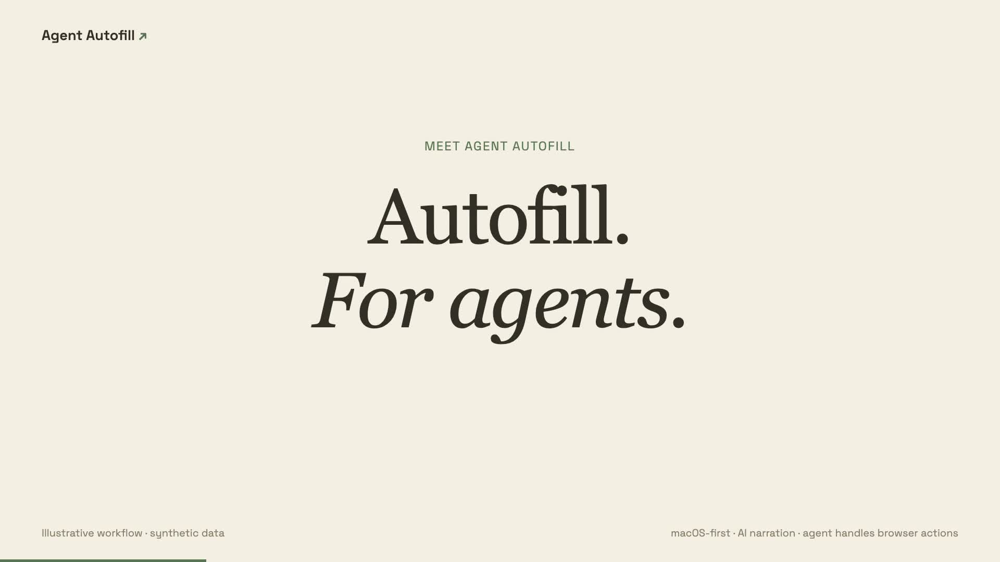
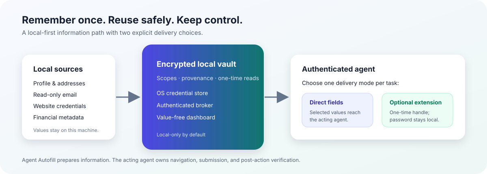
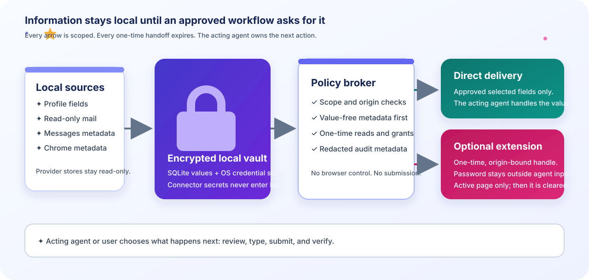

# Agent Autofill

<p align="center">
  <strong>Local encrypted autofill and 2FA broker for AI agents.</strong><br>
  Give Claude, Cursor, Codex, and Antigravity your saved profiles, logins, payment cards, and live <strong>Mac Messages (zero Full Disk Access)</strong> or email OTP codes over local MCP — while keeping secrets encrypted on your Mac and form submission behind your confirmation.
</p>

<p align="center">
  <a href="https://pypi.org/project/agent-autofill/"></a>
  <a href="https://glama.ai/mcp/servers/lifan-builds/agent-autofill"></a>
  <a href="https://www.python.org/downloads/"></a>
  <a href="https://modelcontextprotocol.io/"></a>
  
  
  <a href="LICENSE"></a>
</p>

<p align="center">
  <a href="https://clifan.com/agent-autofill/">Website</a> ·
  <a href="#try-it-in-10-seconds">1-command quickstart</a> ·
  <a href="#zero-full-disk-access-mac-messages-2fa">Zero-FDA Mac Messages 2FA</a> ·
  <a href="#watch-the-33-second-product-tour">Product tour</a> ·
  <a href="https://clifan.com/agent-autofill/demo/">Interactive demo</a> ·
  <a href="#choose-your-delivery-mode">Delivery modes</a> ·
  <a href="docs/index.md">Docs</a>
</p>

<p align="center">
  
</p>

## Try it in 10 seconds

Run the memory-only synthetic tour with a single command. It touches no database, Keychain, browser, mailbox, or Messages data:

```bash
uvx agent-autofill demo
```

```text
Agent Autofill demo: ready
Passed: Read an approved profile field through the agent tool
Passed: Deliver a login through a one-time browser handoff
Passed: Revoke the agent and verify the next read is denied
```

**Connect it to your MCP agent** (Claude Desktop, Cursor, Codex, or Antigravity):

```bash
uv tool install agent-autofill
agent-autofill start                                 # create the Keychain-backed encrypted vault
agent-autofill mcp-install --client claude --write   # or cursor, codex, antigravity
```

> **Platform:** macOS first (Keychain, Chrome intake, and Messages 2FA). Linux and Windows support are coming soon.
> Prefer to explore in a browser first? Open the zero-install [interactive synthetic demo](https://clifan.com/agent-autofill/demo/).

Tired of copy-pasting addresses, logins, and 2FA codes into agent sessions? [Star this repo](https://github.com/lifan-builds/agent-autofill) so other builders can find it.

## Zero-Full-Disk-Access Mac Messages 2FA

Most macOS Messages tools ask you to grant **Full Disk Access** to your terminal or AI client — exposing `~/Library/Messages/chat.db` and other protected data. Agent Autofill reads incoming SMS and iMessage verification codes in the background using read-only [`faster-mac-use`](https://github.com/lifan-builds/faster-mac-use) (`fmu-ax`) Accessibility snapshots of `Messages.app` with **zero Full Disk Access, zero focus theft, and no `chat.db` copies**.

```bash
agent-autofill messages-add
agent-autofill messages-test
```

- **Origin-matched by default:** `request_messages_auth_code` matches Apple WebOTP (`@domain #code`), domain, or brand first; pass `sender` or `origin_policy="messages-read"` for generic short-code texts.
- **Transient response only:** extracted OTP codes are returned once to the requesting tool call and never written to logs or audit trails. Tapback reactions and calendar years (`1990`–`2099`) are filtered out automatically.
- **Works with SMS from your iPhone:** enable **iPhone Settings > Apps > Messages > Text Message Forwarding** and keep `Messages.app` running in the background. Passing an explicit `--database` path or `--backend db` keeps read-only `chat.db` support available when needed.

## Watch the 33-second product tour

[](https://github.com/lifan-builds/agent-autofill/blob/main/docs/assets/agent-autofill-tour.mp4)

**Chrome remembers your details. Your agent can reuse the ones you approve.**
[Watch or download the MP4](https://github.com/lifan-builds/agent-autofill/raw/refs/heads/main/docs/assets/agent-autofill-tour.mp4), try the [interactive web demo](https://clifan.com/agent-autofill/demo/), or read [what each scene shows](docs/product-tour.md). *(Illustrated tour with synthetic data, AI narration, and original music; not a live browser recording.)*

<table>
<tr>
<td width="25%"><strong>✦ Encrypted local vault</strong><br>SQLite encrypted at rest; keys and connector secrets stay in OS Keychain.</td>
<td width="25%"><strong>✦ Selectable exposure</strong><br>Metadata-first matching, narrow fields, or one-time extension handles.</td>
<td width="25%"><strong>✦ Live 2FA codes</strong><br>Zero-FDA Mac Messages AX, plus read-only Gmail and IMAP OTP retrieval.</td>
<td width="25%"><strong>✦ Confirmation gate</strong><br>Agents fill forms; external submits and financial actions stay user-confirmed.</td>
</tr>
</table>

> [!IMPORTANT]
> Agent Autofill is information-only and local-first. The broker never drives a browser, sends outbound messages, or submits forms. Selected values returned to a cloud agent enter that provider's context; the acting agent must pause for fresh user confirmation immediately before any external submit, and financial information always requires confirmation.

## How the pieces fit

<p align="center">
  
</p>

```text
local sources (Chrome, Gmail/IMAP, Mac Messages)
        |
        v
encrypted broker (Keychain key, scopes, redaction, one-time OTP/handles)
   |         |                 \
Inbox    MCP stdio          optional Chrome extension
```

- **Broker:** validates scopes, matches metadata without exposing values, and owns one-time reads.
- **Inbox (`inbox-web`):** loopback-only, read-only inventory and grant health view (`What is stored?` and `What needs attention?`).
- **MCP transport (`agent-autofill-server`):** authenticated local JSON-lines stdio server. Keychain-paired local services use their trusted local identity for read paths and reviewed writes; older or remote clients use explicit short-lived grants.
- **Optional extension:** consumes an origin-bound credential handle locally so passwords never enter agent input.

## LLM-guided record matching

Forms do not need a hard-coded profile schema. The acting agent sends only visible field metadata to `match_form_fields`, and Agent Autofill returns a ranked, value-free table:

| Step | What happens | Agent behavior |
| --- | --- | --- |
| **Rank** | Candidate records are scored by label meaning, Chrome field semantics, and value-free learned mappings. | Try the first high-confidence row. |
| **Clarify** | Tied or missing rows include one focused `question` (such as which saved address to use). | Use page context first; ask the user only when ambiguous. |
| **Remember** | After confirmation or correction, `record_form_mapping_feedback` stores only field IDs, origin, purpose, and outcome. | Put that choice first next time. |

No profile value is sent merely to rank candidates, and matching never approves external submission.

## Three safe agent workflows

Start with the [three-part Agent Autofill skill](.agents/skills/agent-autofill/SKILL.md) (plus [form memory](.agents/skills/agent-autofill-form-memory/SKILL.md), [Chrome intake](.agents/skills/agent-autofill-chrome-intake/SKILL.md), and the [Chrome seed onboarding guide](docs/chrome-seed-onboarding.md)).

| Workflow | What the agent does | User control and boundary |
| --- | --- | --- |
| **1. Use saved data** | Match metadata first (`list_credentials` with optional `username_hint`, semantic group resolution, `match_form_fields`), then request only fields needed for the current origin and purpose. | Values stay transient. Credential delivery is explicitly `direct` or `extension`; OTPs are one-time reads. Fresh confirmation before external submit, purchase, or account change. |
| **2. Propose new saved entries** | Turn a user-supplied or verified stable value into a structured add/update proposal with sensitivity, scope, and confidence. | Nothing is written until the user approves exact rows. Passwords, full payment values, tokens, and OTPs never enter profile proposals; newly created website logins default to reviewed dual-save. |
| **3. Import from Chrome** | Read structured autofill names, contacts, and addresses from a selected local Chrome profile, keeping source groups separate. | Local and read-only snapshots. Saved-password import (macOS v10/v11) is a separate local-only opt-in; v20/App-Bound Encryption and passkeys stop safely. |

When a form asks for a field that is not saved yet, the acting agent asks once in context — **use once**, **save to Agent Autofill**, or **skip** — showing one compact confirmation card so saving the reusable record and its narrow write scope happens in a single approval without approving form submission.

## Choose your delivery mode

Agent Autofill supports two explicit ways to deliver a website credential. Direct CLI/MCP delivery is the default; the Chrome extension is optional.

| Mode | What crosses into agent input | Choose it when |
| --- | --- | --- |
| **Direct** | Only approved selected fields | The acting agent is allowed to handle the value and complete the step. |
| **Optional extension bridge** | A short-lived, origin-bound handle; the password stays out of agent input | You want lower-exposure local password delivery after reviewing the grant. |

```bash
# 1. Inspect credential metadata without returning passwords
agent-autofill --db ~/.agent-autofill.sqlite3 \
  credentials list --target-origin https://example.test

# 2. Grant site access with an explicit delivery mode
agent-autofill --db ~/.agent-autofill.sqlite3 \
  grant-site agent-1 https://example.test "account setup" --delivery direct

# 3. Optional: start the loopback bridge and load browser_extension/ as an unpacked Chrome extension
agent-autofill --db ~/.agent-autofill.sqlite3 fill-server
```

Configure form-submission confirmation (`always` by default; `non-financial` allowed for ordinary forms, while financial forms always require confirmation):

```bash
agent-autofill --db ~/.agent-autofill.sqlite3 policy form-submission --confirmation non-financial
agent-autofill --db ~/.agent-autofill.sqlite3 policy form-submission --json
```

## Security model

<p align="center">
  
</p>

- SQLite values are encrypted with a key stored in the OS credential store (macOS Keychain).
- IMAP and OAuth connector secrets stay in Keychain — never in files, prompts, or environment variables.
- Local review and fill HTTP servers bind strictly to loopback (`127.0.0.1` / `localhost` / `::1`).
- Passwords, full payment numbers, security codes, mailbox tokens, message bodies, and OTPs never appear in logs, audits, listings, or diagnostics.

## What the local vault can remember

Synthetic examples of what you can store and how agents access it:

| Record | Example stored data (synthetic) | What an agent can request |
| --- | --- | --- |
| **Identity** | `legal_name`: "Synthetic Demo User"; `date_of_birth`: `1990-04-12`; phone; primary & backup email | Only named fields for one origin and purpose |
| **Addresses** | Separate reviewed groups for home (`100 Demo Way`, `98101`) and shipping | A selected address group or individual fields, with provenance |
| **Preferences** | Organization, dietary preference, accessibility preference, stable form answers | Named preference fields; asks when a form needs something new |
| **Website credential** | `example.test` username + encrypted password + optional note | Direct selected fields or a one-time origin-bound extension handoff |
| **Payment card** | Network, last four `4242`, expiration `05/2031`; encrypted card number & security code | Metadata matching first, then approved checkout fields only |
| **Email source** | Read-only IMAP or Gmail account (`owner@example.test`) | Scoped search/read, or one recent OTP via `request_auth_code` |
| **Mac Messages source** | Read-only macOS Messages via zero-FDA `faster-mac-use` AX (or explicit `chat.db`) | Origin-matched SMS/iMessage 2FA via `request_messages_auth_code`, plus scoped `list_conversations` / `search_messages` / `get_message` (no send/delete) |

Quick metadata CLI examples:

```bash
agent-autofill --db ~/.agent-autofill.sqlite3 email-match owner@example.test
agent-autofill --db ~/.agent-autofill.sqlite3 profile list --category identity --limit 20
agent-autofill --db ~/.agent-autofill.sqlite3 financial-records --kind payment_card --last4 1234
agent-autofill --db ~/.agent-autofill.sqlite3 grant-email codex email.otp owner@example.test --expires-in 600
```

## Example agent journeys

<details>
<summary><strong>6 end-to-end browser workflows Agent Autofill unlocks</strong> (hotel booking, job applications, 2FA account recovery, checkout, event registration, missing-field memory)</summary>

1. **Book a hotel without pasting a password or card number:** Match the saved login by exact origin, fill via a one-time extension handle (password stays out of the transcript), pull `legal_name` + billing address + live email or Mac Messages 2FA code, match the card by last four, and pause for mandatory financial confirmation before checkout.
2. **Complete a job application with scoped identity fields:** Approve only name, phone, email, address, and birthdate for one recruiting origin; pause on optional demographic questions instead of guessing; confirm before submitting.
3. **Recover a support portal with an email or SMS code:** Match the portal login, request one recent email OTP or zero-FDA Mac Messages code (`request_messages_auth_code`), enter the code, and stop at any password change or security consent.
4. **Check out online without standing grants:** Match shipping address and card hints under a short-lived checkout grant, keep unrelated cards/addresses local, and require mandatory financial confirmation before purchase.
5. **Register for an event from reusable profile memory:** Share only selected identity and preference fields (dietary, accessibility, org), fetch a verification code if prompted, and let the grant expire afterward.
6. **Save a new field mid-task without losing flow:** When a form asks for an unsaved field like company name, the agent offers **use once**, **save to Agent Autofill**, or **skip** in one compact card, persists approved records via `write_records`, and still pauses at the final submission gate.

</details>

## Setup, CLI, and MCP configuration

Install with `uv` or `pipx` (or editable `python3 -m pip install -e .` for contributors):

```bash
uv tool install agent-autofill      # or: pipx install agent-autofill
```

Inspect your vault before connecting an agent:

```bash
agent-autofill --db ~/.agent-autofill.sqlite3 init
agent-autofill --db ~/.agent-autofill.sqlite3 quickstart   # value-free readiness summary
agent-autofill --db ~/.agent-autofill.sqlite3 inbox-web    # loopback read-only review page
agent-autofill --db ~/.agent-autofill.sqlite3 setup        # guided identity & connector setup
agent-autofill --db ~/.agent-autofill.sqlite3 doctor       # Keychain, source, Messages & grant checks
```

Preview the MCP config before writing (`mcp-install` pairs a local service identity in Keychain):

```bash
agent-autofill mcp-install --client cursor
```

```json
{
  "mcpServers": {
    "agent-autofill": {
      "command": "agent-autofill-server",
      "args": ["--service", "cursor"]
    }
  }
}
```

## Documentation map

Start at the [docs hub](docs/index.md), or jump to a specific guide:

| I want to… | Read |
| --- | --- |
| Install and complete my first safe run | [Getting started](docs/getting-started.md) |
| Seed autofill and optionally saved passwords from Chrome | [Chrome seed onboarding](docs/chrome-seed-onboarding.md) |
| Understand direct versus extension delivery | [Access modes](docs/access-modes.md) |
| Find the right command | [CLI cookbook](docs/cli.md) |
| Recover from Keychain, Chrome, Messages, or bridge issues | [Troubleshooting](docs/troubleshooting.md) |
| Understand the architecture and MCP surface | [Architecture and operator guide](docs/agent-autofill.md) |
| Check platform and feature coverage | [Support matrix](docs/support-matrix.md) |
| Add code safely | [Package guide](agent_autofill/README.md) |
| Use the optional Chrome extension | [Extension guide](browser_extension/README.md) |
| Run form-filling scenarios | [Evaluation set](evals/form_filling/README.md) |

## Development

```bash
python3 -m pytest -q tests
node --test tests/agent_autofill/*.test.cjs
ruff check agent_autofill tests
mypy agent_autofill
python3 -m compileall -q agent_autofill tests
git diff --check
```

Cross-layer synthetic smoke test (memory-only; never touches Keychain, vault, browser, mail, or Messages):

```bash
python3 -m pytest -q tests/agent_autofill/test_workflows_e2e.py
```

Read the [support matrix](docs/support-matrix.md) before integrating, and use [SECURITY.md](SECURITY.md) for responsible vulnerability reports. Use synthetic values only in tests, fixtures, screenshots, and documentation.

<p align="center">
  <strong>✦ Remember once. Reuse safely. Keep control. ✦</strong><br>
  If Agent Autofill saves you time on local agent workflows, consider starring the repo or sharing an evaluation case.
</p>

<!-- mcp-name: io.github.lifan-builds/agent-autofill -->

## License

Open source under [AGPL-3.0-only](https://github.com/lifan-builds/agent-autofill/blob/main/LICENSE), with the Section 7 attribution terms in [ATTRIBUTION.md](ATTRIBUTION.md). Copies and modified versions must keep this credit in their README and `--version` or About output, mark their changes, and may not use the Agent Autofill name:

> Based on Agent Autofill by lifan-builds (https://github.com/lifan-builds/agent-autofill)

Copyright © 2026 [lifan-builds](https://github.com/lifan-builds). Pull requests are welcome under [CONTRIBUTING.md](https://github.com/lifan-builds/agent-autofill/blob/main/CONTRIBUTING.md) with a one-time [CLA](https://github.com/lifan-builds/agent-autofill/blob/main/CLA.md). For licensing outside AGPL, open an issue.
