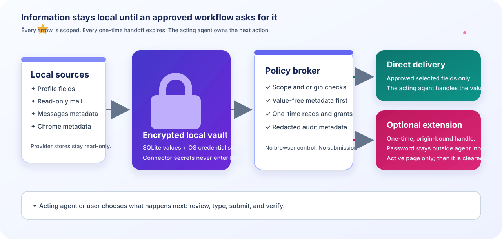

# Agent Autofill

<p align="center">
  <a href="index.md">Docs hub</a> ·
  <a href="getting-started.md">Getting started</a> ·
  <a href="access-modes.md">Access modes</a> ·
  <a href="cli.md">CLI cookbook</a> ·
  <a href="troubleshooting.md">Troubleshooting</a>
</p>

> [!NOTE]
> This is the detailed operator and integration reference. If you are new to
> the project, begin with [Getting started](getting-started.md). If you are
> deciding how a password reaches an agent, begin with [Access modes](access-modes.md).
> The dashboard is read-only; agents request information through the CLI/MCP
> path.

<p align="center">
  
</p>

This package is a local MCP information service. It keeps profile values,
connector configuration, credentials imported during cold start, grants, and
audit metadata in an encrypted application store. Connector secrets are held
in one versioned `vault:v1` item in macOS Keychain through Python `keyring`.

The vault contains the database encryption key and connector secrets together,
and a running CLI process caches it after the first access. This avoids a
separate Keychain unlock for each connector while keeping all secret material
OS-store-backed. Older releases created one Keychain item per database path or
connector; the broker migrates those entries after the consolidated vault is
durably written and then removes the legacy item. The first migration can
require Keychain approval; later broker operations use the single vault item.
To retry migration for configured connectors:

```bash
agent-autofill \
  --db /Users/lfan/.agent-autofill.sqlite3 keychain migrate
```

The command prints only a count. Secret values never enter SQLite, logs, or
the migration summary. Chrome's own `Chrome Safe Storage` item remains a
separate Chrome-managed credential when importing Chrome passwords.

Gmail OAuth persistence and authenticated credential/financial field reads are
delivered. Keychain-paired local services can read those fields directly;
legacy or remote callers can use the existing `grant` command when they need a
narrower policy.

## Agent-led Chrome intake

For reviewed cold-start data, ask your local agent to use
[`agent-autofill-chrome-intake`](../.agents/skills/agent-autofill-chrome-intake/SKILL.md):

> Help me bootstrap Agent Autofill from my selected Chrome profile. Organize
> the saved names, contact details, and addresses, ask me about ambiguities,
> then show all proposed changes for final approval before saving anything.

The host agent supplies the reasoning. After source-read authorization, it
reads only supported structured
address fields, keeps source groups separate, and proposes exact records and
scopes. Clear matches are included in the final review, not saved silently.
Approve the displayed batch or selected rows; unresolved items stay excluded.
Selected ordinary values enter the host agent's conversation context and
follow that provider's retention settings. No candidate export or staging
database is created by the workflow.

This skill requires local execution access. It stops on locked/unsupported
Chrome data and may ask you to close Chrome; it never closes the browser for
you. Passwords, payments, OTPs, and arbitrary autocomplete history are excluded.
Existing local administrative writes are used after approval, with individual
commits: a failure reports saved and pending record IDs, not an atomic rollback.
Approval is enforced by the consuming agent's instructions, not a new
broker-side consent token. Normal MCP authentication and grant rules remain
unchanged.

The `setup` and `chrome import` commands below are separate, eager import
paths. They do **not** implement this review-before-save workflow. Do not run
them as a shortcut during agent-led intake.

## Setup

Install the command once from the repository root:

```bash
uv tool install .
```

`pipx install .` is equivalent. These installs expose `agent-autofill` and
`agent-autofill-server` on your `PATH`.

### Installed local service connection

Services use the installed broker through a stable lowercase service name. The
identity handshake is automatic when the service launches its local server; a
client does not need a separate `connect` step or grant command. A
Keychain-paired local service receives trusted read access to all information
already stored in Agent Autofill:

```bash
agent-autofill serve --service cpa-phoenix
```

The broker discovers an existing `~/.agent-autofill.sqlite3`, stores the
service token in the OS credential store, and binds requests to that identity.
This local pairing is the owner's access decision: read operations do not need
expiring grants or target-origin/purpose scopes. Writes remain confirmation-
and grant-protected, and revoking the service identity stops access. Future
services use the same contract.

For email, clients pass the recipient address to
`request_auth_code_for_recipient`. The broker resolves the exact configured
mailbox internally and rejects missing or duplicate addresses, so clients do
not need a source map. Legacy or remote callers can create the matching
one-time grant:

```bash
agent-autofill grant-email service:cpa-phoenix email.otp \
  owner@example.test --origin https://auth.openai.com \
  --purpose cpa-phoenix-revive
```

The command resolves the address internally; the opaque source ID need not be
copied into Phoenix configuration.

```bash
agent-autofill \
  --db /Users/lfan/.agent-autofill.sqlite3 init
agent-autofill \
  --db /Users/lfan/.agent-autofill.sqlite3 setup
```

Before starting or resuming setup, inspect the value-free readiness summary:

```bash
agent-autofill \
  --db /Users/lfan/.agent-autofill.sqlite3 quickstart
agent-autofill \
  --db /Users/lfan/.agent-autofill.sqlite3 doctor
```

These commands check the encrypted broker, OS credential store, configured
source state, agents, and expiring grants. They print counts and next actions
only; profile values, passwords, connector secrets, tokens, and OTPs are never
included. They are read-only and can be repeated between explicit setup steps.

### Keychain access troubleshooting

The encrypted database key and connector credentials are intentionally read
from the macOS login Keychain. A restricted process, a locked login Keychain,
or a Keychain permission denial can surface as `OS credential store
unavailable`. Run `doctor` from a normal host process after unlocking the login
Keychain in Keychain Access. The doctor path reports the blocker and recovery
action without a Python traceback or secret material. Never work around the
boundary by placing the database key, connector credentials, or service token
in a file or environment variable.

If setup left the agent identity blank, create one explicitly:

```bash
agent-autofill \
  --db /Users/lfan/.agent-autofill.sqlite3 agent-create codex
```

Do not run `agent-create` again for an existing identity: the setup flow keeps
the existing token and does not silently rotate it. Continue with explicit
grants only when the identity and token are already available:

```bash
agent-autofill \
  --db /Users/lfan/.agent-autofill.sqlite3 grant codex profile.read name \
  --origin example.com --purpose form
agent-autofill \
  --db /Users/lfan/.agent-autofill.sqlite3 grant codex credential.use <credential-id> \
  --origin https://example.com --purpose form
agent-autofill \
  --db /Users/lfan/.agent-autofill.sqlite3 grant codex credential.read <credential-id> \
  --origin https://example.com --purpose form
agent-autofill \
  --db /Users/lfan/.agent-autofill.sqlite3 grant codex financial.read <financial-record-id> \
  --origin https://example.com --purpose form
agent-autofill \
  --db /Users/lfan/.agent-autofill.sqlite3 grant codex email.otp personal-mail \
  --origin https://example.test --purpose login
```

### Optional first-run grants

At the end of `setup`, when the requested agent identity is nonempty, the
wizard offers an optional authorization step. It reads metadata only and
shows no profile values, imported passwords, mailbox credentials, connector
secrets, or agent token beyond the deliberate one-time token output. The
operator can select these permissions independently:

- `profile.read` for exact saved profile field IDs;
- `email.search` for one exact configured email account; and
- `email.otp` for that account.

The profile and OTP selections each require a nonempty target origin and
purpose. The email-search grant is intentionally account-scoped and has no
origin or purpose. The wizard does not propose wildcard, write, credential,
financial, Messages, or `email.read` grants.

Before writing any new grant, the wizard presents a value-free preview with
the exact operations, resources, origin/purpose scopes, and fixed 600-second
lifetime. The preview explicitly says that email search covers the selected
account, not only messages associated with the target origin. An affirmative
confirmation is required before the validated grant proposal is persisted.
Skipping the step, leaving the identity blank, cancelling, declining
confirmation, or providing an invalid/incomplete selection creates no new
grants; existing tokens and grants remain unchanged, and a revoked identity
is not silently reactivated. Earlier imports and connector configuration are
not rolled back when this optional step is skipped.

Wizard grants expire after 600 seconds. Renew them with the existing
`grant` command, which remains unchanged; for example:

```bash
agent-autofill \
  --db /Users/lfan/.agent-autofill.sqlite3 grant codex profile.read name \
  --origin https://example.test --purpose form --expires-in 600
agent-autofill \
  --db /Users/lfan/.agent-autofill.sqlite3 grant codex email.search personal-mail \
  --expires-in 600
agent-autofill \
  --db /Users/lfan/.agent-autofill.sqlite3 grant codex email.otp personal-mail \
  --origin https://example.test --purpose login --expires-in 600
```

### Interactive profile fields

Use the interactive profile path when adding or replacing a value. The value
is read through a hidden prompt, so it does not enter shell history or process
arguments. Review the metadata-only proposal before confirming the encrypted
write:

```bash
agent-autofill \
  --db /Users/lfan/.agent-autofill.sqlite3 profile add legal_name
agent-autofill \
  --db /Users/lfan/.agent-autofill.sqlite3 profile edit legal_name
```

The proposal includes the field ID, category, display name, sensitivity, and
scopes only. Profile listings, audits, and the Inbox keep the entered value
omitted.

The wizard can import Chrome autofill data and login metadata from a selected
profile, optionally import a user-exported Chrome password CSV after typing
`IMPORT`, and configure read-only IMAP and local Messages sources. For a direct
Chrome Password Manager connection on macOS, close Chrome and run the separate
explicitly confirmed command below. It reads the encrypted `Login Data`
records with Chrome's `Chrome Safe Storage` Keychain item, supports Chrome's
v10/v11 password format, and seals each password immediately in the encrypted
broker. Unsupported encryption fails closed and does not create credentials.

```bash
agent-autofill \
  --db /Users/lfan/.agent-autofill.sqlite3 chrome password-manager \
  --profile-dir "/Users/lfan/Library/Application Support/Google/Chrome/Default" \
  --confirm-import
```

The command prints only a value-free reconciliation summary. It does not print
passwords or store them in audit metadata. After import, use the authenticated
unified `request_credential` operation with an explicit delivery choice and an
origin and purpose grant; the legacy `request_credential_fields` and
`request_credential_use` operations remain available for compatibility. There
is no unscoped password retrieval.
The broker still does not control Chrome or submit forms.

### Password Manager preview and sync

The import command also supports a value-free reconciliation preview. Close
Chrome before reading its profile files:

```bash
agent-autofill \
  --db /Users/lfan/.agent-autofill.sqlite3 chrome password-manager \
  --profile-dir "/Users/lfan/Library/Application Support/Google/Chrome/Default" \
  --preview
```

The preview reports counts and value-free origin/username metadata for
additions, changed passwords, unchanged entries, and credentials that
disappeared from Chrome. Apply additions and updates only with
`--confirm-import`. Stale entries are retained unless the same command
also includes `--remove-stale`, which is a separate explicit deletion choice.
The sync reads v10/v11 encrypted Login Data through the unlocked Chrome Safe
Storage Keychain item. Chrome v20/App-Bound Encryption and passkeys are
unsupported and fail closed without writing credentials.

### Site matching, grants, and delivery modes

`match_credentials` returns exact-host credential metadata and accepts an
optional username hint. `list_profile_groups` returns metadata-only groups for
Chrome structured addresses or local profile fields. Neither operation returns
passwords or profile values. A site grant can be previewed and confirmed from
the CLI:

```bash
agent-autofill \
  --db /Users/lfan/.agent-autofill.sqlite3 grant-site codex \
  https://www.hilton.com "hotel booking" --delivery extension
```

The command shows matching names, usernames, origins, and the requested
short-lived scope before writing anything. Use `--delivery direct` when the
agent should receive selected fields, or `--delivery extension` when the
password should stay outside the agent input. Declining leaves existing grants
unchanged. It does not display or persist a password in the proposal.

After the grant is approved, choose one delivery mode:

- **Direct agent handling:** call the authenticated,
  `request_credential` operation with `delivery="direct"` and approved field
  IDs. The selected value is returned to the agent, which handles the rest of
  the workflow.
- **Optional extension handling:** call `request_credential` with
  `delivery="extension"` to obtain a short-lived, origin-bound handle. The
  local extension consumes the handle and fills the active page, so the
  password does not enter the agent's input. This is the lower-exposure option,
  at the cost of installing and running the local bridge.

The exact-origin and purpose grant preview is the consent boundary. The
extension handle is a scoped, one-time verification handoff, not a reusable
verification link or proof that the site accepted the value. Agent Autofill
does not navigate, submit, or verify the result after delivery; review the
page and submit it yourself.

The unified request refuses an omitted or unknown delivery mode and never falls
back from one mode to the other. Direct mode requires `field_ids`; extension
mode rejects them and returns only the handle metadata.

To use a confirmed one-time `credential.use` handle in Chrome, load the
`browser_extension/` directory as an unpacked extension in developer mode and
start the local bridge:

```bash
agent-autofill \
  --db /Users/lfan/.agent-autofill.sqlite3 fill-server
```

On the active HTTPS page, open the extension popup and review the displayed
origin and bridge state. The popup remembers only the nonsecret agent ID and
loopback bridge URL; enter the one-time handle only after the approved
`credential.use` request. The bridge is loopback-only, verifies the page origin
before consuming the handle, sends `Cache-Control: no-store`, and permits each
handle once. The extension clears the handle after every attempt, dispatches
only username/password `input` and `change` events, and never navigates, clicks,
or submits the page; the user reviews and submits it.

For a generic Thunderbird-style IMAP source, use `email-add`. The command
checks the login and read-only mailbox selection before saving the password or
OAuth2 bearer token in Keychain. Encrypted SQLite stores only connection
metadata and an opaque Keychain lookup name:

```bash
agent-autofill \
  --db /Users/lfan/.agent-autofill.sqlite3 email-add personal-mail \
  imap.example.test user@example.test --mailbox INBOX
agent-autofill \
  --db /Users/lfan/.agent-autofill.sqlite3 email-test personal-mail
```

`email-test` reconnects with the saved Keychain secret and prints only source
metadata. Each broker/server process opens a fresh TLS connection, selects the
mailbox read-only, performs its operation, and logs out; a live IMAP socket is
never serialized. Replace a source by running `email-add` again. Disconnect it
with `source-remove`, which deletes the current Keychain secret before
removing local metadata.

For Gmail, use a Google Cloud Desktop OAuth client that you own. In Google
Cloud, enable the Gmail API, configure the OAuth consent screen (choose
External for a personal Gmail account and add that account as a test user),
add `https://mail.google.com/` under Data Access, then create an OAuth client
with application type Desktop app and download its JSON. Agent Autofill does not
bundle or publish a shared client:

```bash
agent-autofill \
  --db /Users/lfan/.agent-autofill.sqlite3 email-add-gmail personal-gmail \
  user@gmail.com --client-secrets /private/path/client-secret.json
agent-autofill \
  --db /Users/lfan/.agent-autofill.sqlite3 email-test personal-gmail
```

`email-add-gmail` opens Google Sign-In in the system browser, receives the
authorization code only on a temporary `127.0.0.1` listener, validates state
and PKCE, and checks Gmail XOAUTH2 access by selecting the requested mailbox
read-only before saving. The Keychain stores only the client id, optional
client secret, and refresh token; encrypted SQLite stores non-secret source
metadata and the opaque Keychain name. Access tokens remain in memory and are
refreshed when a later process needs a new IMAP connection. Gmail exposes the
full `https://mail.google.com/` scope for IMAP even though this adapter never
writes mail or sends messages.

To verify OAuth accounts already configured in Thunderbird, run:

```bash
agent-autofill \
  --db /Users/lfan/.agent-autofill.sqlite3 email-test-thunderbird
```

The command discovers the active macOS profile, excludes Local Folders, and
prints only masked usernames, provider, host, and status. It decrypts saved
refresh tokens in memory through Thunderbird's NSS library, refreshes OAuth,
selects `INBOX` read-only, and logs out. It does not read message bodies, send
or change mail, or import tokens into Agent Autofill.

After reviewing the metadata-only proposal, import the verified connectors with
an explicit confirmation:

```bash
agent-autofill \
  --db /Users/lfan/.agent-autofill.sqlite3 email-import-thunderbird \
  --confirm-import
```

Each imported source is named `thunderbird-<account-id>`. The encrypted SQLite
database stores only connection metadata and an opaque Keychain name; the
provider-specific refresh/client payload is stored in macOS Keychain. The
import refuses to write anything unless every selected account passes the same
read-only verification first.

After import, normal broker reads use the saved Agent Autofill source and no
longer read the Thunderbird profile. Test a saved connector with
`email-test thunderbird-<account-id>`. Google and Microsoft connectors refresh
at their respective provider endpoints; rotated refresh tokens are written
back to the same Keychain connector entry. Access tokens stay in memory.
Mail search and message reads continue to use the existing authenticated,
account-scoped `email.search` and `email.read` grants.

Google marks External consent clients in Testing as having refresh tokens that
expire after seven days for this Gmail scope. If that happens, `email-test`
fails safely and the operator must run `email-add-gmail` again. For an opt-in
live smoke test, use only a mailbox and Desktop client you explicitly own,
run `email-add-gmail` followed by `email-test`, and remove the source with
`source-remove`; never put live addresses, messages, OAuth tokens, or client
JSON in repository files or diagnostics.

Automated coverage uses a deterministic fake IMAP provider. A live smoke test
is opt-in: use only a mailbox you explicitly provide, run `email-add` followed
by `email-test`, and remove it afterward. Do not copy live messages, addresses,
passwords, bearer tokens, or OTPs into repository files or diagnostics.

The first-run integration coverage is fixture-only: it drives the CLI setup
entry point with synthetic Chrome metadata and a fake persisted IMAP adapter,
then reopens the encrypted database through the server JSON-lines entry point.
This proves storage, connector reconstruction, authorization, serialization,
and protocol behavior with fakes; it does not establish installation,
subprocess, live Keychain, live IMAP, or live Gmail/provider acceptance.

macOS may require granting the terminal or Python process Full Disk Access to
read `~/Library/Messages/chat.db`; the adapter reports a clear unavailable
error when that permission is absent.

To run the local MCP process for a client:

```bash
agent-autofill \
  serve --service cpa-phoenix
```

For a human review page, run `inbox-web` and open the printed loopback URL:

```bash
agent-autofill \
  --db /Users/lfan/.agent-autofill.sqlite3 inbox-web
```

The Agent Inbox dashboard first shows what is stored and what needs attention,
then keeps source, agent, grant, profile-field/group, credential,
financial-record, and recent-audit metadata in advanced disclosures. Stored
values and connector secrets are omitted. It accepts loopback hosts only.

The process uses MCP `initialize`, `tools/list`, and `tools/call` JSON-RPC
messages over stdin/stdout. Installed services launch it with their stable
service name; token recovery and identity binding happen inside Agent Autofill
through Keychain. Local services receive trusted read access automatically.
Explicit grants remain available for legacy, remote, or deliberately narrow
clients, and the legacy token/environment mode remains available for older
clients.

A Codex MCP entry follows this shape (keep the token in the process environment
or a secret manager, not in source control):

```toml
[mcp_servers.agent-autofill]
command = "agent-autofill"
args = ["serve", "--service", "cpa-phoenix"]
```

The information surface is intentionally local and information-only. It does
not expose unscoped password retrieval, message send/delete operations,
browser control, or form submit. For imported credentials, the unified
`request_credential` operation requires an explicit direct or extension delivery
mode. Extension delivery returns an origin-bound, short-lived handle plus the
username; direct delivery returns only selected fields. The compatibility
`request_credential_use` and `request_credential_fields` operations remain
available. Financial fields use `request_financial_fields`; these tools require
an authenticated agent. Local
services use their Keychain-bound trusted identity, while legacy and remote
agents use matching grants and record scopes. A local read does not create a
second per-use approval prompt.
Raw values appear only in that successful scoped response and are never put in
listings, audits, errors, or documentation. The consuming agent remains
responsible for any separate approval before browser typing or submission.

For form/origin-scoped workflows with the required record-write grants,
after the consuming skill has obtained exact user approval for a proposal, it
may submit the approved entries in one authenticated `write_records` call with
`confirmed: true`. The broker validates every entry and returns metadata-only
created/updated/unchanged statuses. Passwords and payment/financial maps must
use their dedicated `credential` and `financial` record types rather than
profile fields; transient OTPs, tokens, cookies, sessions, and handles are
rejected.

Chrome cold-start intake instead uses the local administrative profile-write
path described above; it must not fabricate an origin or grant for this API.

For local administration, list safe financial metadata or delete one record:

```bash
agent-autofill \
  --db /Users/lfan/.agent-autofill.sqlite3 financial-records list
agent-autofill \
  --db /Users/lfan/.agent-autofill.sqlite3 record-delete financial <financial-record-id>
```

To add or replace a payment card locally, use the review-first command below.
The card number and security codes are entered through hidden prompts, never as
shell arguments. The proposal shows only masked metadata and the
record is written to encrypted storage only after an explicit `y` response:

```bash
agent-autofill \
  --db /Users/lfan/.agent-autofill.sqlite3 payment-card-add \
  platinum-card "Travel Platinum" --network amex \
  --expiration-month 05 --expiration-year 2031 \
  --origin https://www.hilton.com --purpose "hotel booking"
```

Reusing the record ID replaces the existing encrypted card after the same
confirmation. The add preview surfaces matching metadata from other cards so
an existing record ID can be reused instead of creating an accidental
duplicate. Listings and matching stay metadata-only; full card fields
remain available to an authenticated `request_financial_fields` read.
Keychain-paired local services may omit the origin/purpose context; legacy or
remote agents use the origin/purpose-scoped grant path.

When a wallet has duplicate cards or more than one expiration date, match the
masked metadata before requesting any card fields. Matching is exact and
returns metadata only; the later field read uses the Keychain-paired local
service directly, or the normal origin/purpose-scoped `financial.read` grant
for legacy/remote agents:

```bash
agent-autofill \
  --db /Users/lfan/.agent-autofill.sqlite3 financial-records \
  --kind payment_card --network amex --last4 1007 \
  --expiration-month 05 --expiration-year 2031
```

The MCP `match_financial_records` tool exposes the same safe selector for
agents. Expiration month/year are treated as masked matching hints, alongside
network and last four; full card numbers and security codes never appear in
the match response or its audit metadata.

Deletion removes the encrypted record, invalidates any compatibility handle
for that credential, and revokes grants that name the exact record. Wildcard
category grants remain capabilities but cannot read a deleted record.

To request an email OTP, the authenticated agent needs an active
`email.otp` grant scoped to the account, target origin, and purpose. A
successful request returns one recent target-bound code plus
email/message/received-time provenance; the code is never stored, audited, or
included in an error. The broker requires exactly one recent numeric candidate
within `max_age_seconds` before checking that the normalized target hostname
appears as a complete token in the candidate message. It does not choose the
newest candidate when multiple candidates are present, and the response has no
confidence or `expires_in` field. Consumption is keyed by agent, account, and
message, so the same agent cannot reuse a returned message. For example, a
client calls `request_auth_code` with an argument shape like:

```json
{
  "account_id": "personal-mail",
  "target_origin": "https://example.test",
  "purpose": "login",
  "max_age_seconds": 300
}
```

The broker refuses stale or ambiguous candidates and reuse of a returned
message by the same agent. Keychain-paired local services do not need an
email-read grant; legacy or remote callers still receive the existing
missing/expired/wrong-scope grant errors. It only reads mail; browser typing
and form submission remain outside this project.

`search_email` is account-scoped: it accepts a query and bounded result limit,
but has no time-window or origin filter and is not an OTP-only search. Local
services can use it after Keychain pairing; legacy and remote agents need the
separate `email.search` grant for the exact account. Treat its results as
authorized mailbox content rather than as target-origin proof.

For recipient-scoped verification links, first match the exact configured
mailbox using safe metadata:

```bash
agent-autofill \
  --db /Users/lfan/.agent-autofill.sqlite3 email-match owner@example.test
```

`email-match` calls `match_email_sources(recipient)` and prints only source
metadata such as provider, label, kind, and an opaque local source identifier.
It never prints the recipient, message content, OTP, connector secret, or
verification URL. The same bounded MCP entry point has the shape:

```json
{"recipient": "owner@example.test"}
```

After the user explicitly confirms the exact recipient, target origin, purpose,
and freshness window, an authenticated client may call
`request_verification_link_for_recipient`:

```json
{
  "recipient": "owner@example.test",
  "target_origin": "https://auth.example.test",
  "purpose": "account recovery",
  "max_age_seconds": 300
}
```

The broker requires the matching `email.verification_link` grant, finds one recent
recipient-bound candidate, and returns one transient origin-bound link with
minimal provenance only to the authenticated requester. The URL is excluded
from CLI diagnostics, audits, and persisted metadata; do not replay or log it.
This workflow does not navigate, submit, or verify the destination after the
response.

Disconnect a mailbox or Messages source with `source-remove`; this removes its
local connection record, deletes its Keychain secret when present, and revokes
grants scoped to that source:

```bash
agent-autofill \
  --db /Users/lfan/.agent-autofill.sqlite3 source-remove personal-mail
```
