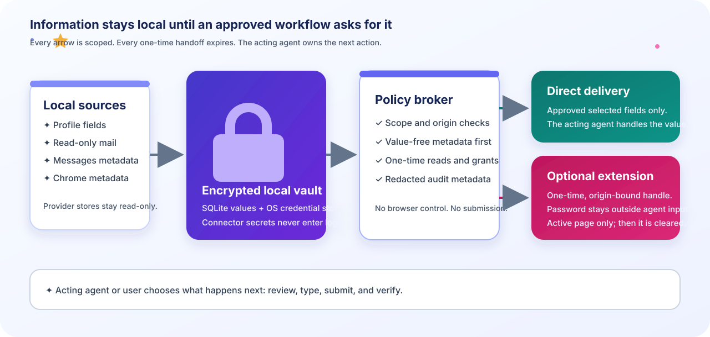

# Agent Autofill docs

  <strong>✦ A calmer way to give agents the information they need ✦</strong> 
  <em>Local memory. Selectable exposure. Human-controlled actions.</em>

Agent Autofill is an information layer for local agent workflows. The docs are
organized around the moment you are in, so you can start small and add sources
when a real task needs them.

> [!IMPORTANT]
> Agent Autofill returns scoped information and the local submission policy.
> The acting agent owns browser navigation and must obtain fresh confirmation
> immediately before submitting; financial information always requires it.

## Pick a path

<table>
<tr>
<td width="33%"><strong>① I am new</strong> <a href="getting-started.md">Complete the first safe run</a> <small>Install, inspect the inbox, and unlock the local vault.</small></td>
<td width="33%"><strong>② My agent needs information</strong> <a href="access-modes.md">Choose direct or extension delivery</a> <small>Use the CLI to request information with the exposure you choose.</small></td>
<td width="33%"><strong>③ I am integrating</strong> <a href="cli.md">Use the CLI cookbook</a> <small>Find the command and a copy-paste example.</small></td>
</tr>
</table>

## See the product before installing

Open the [interactive synthetic demo](demo/index.html) to walk through the
macOS-first flow: value-free inventory, exact request, human approval,
origin-bound delivery, and revocation. It never reads local files or sends a
network request.

## Guides at a glance

| Guide | Use it for | What you will leave with |
| --- | --- | --- |
| [Getting started](getting-started.md) | First install and first review | A value-free inventory and a clear next action |
| [Chrome seed onboarding](chrome-seed-onboarding.md) | Bootstrap autofill data and optionally saved passwords from Chrome | A reviewed seed proposal plus an opt-in local credential sync |
| [Access modes](access-modes.md) | Credential and form workflows | A deliberate direct or extension handoff |
| [CLI cookbook](cli.md) | Daily operation | Safe status, source, grant, and server commands |
| [Troubleshooting](troubleshooting.md) | Recovery | A diagnosis and an exact retry path |
| [Operator guide](agent-autofill.md) | Full connector and MCP reference | Detailed setup, scopes, and compatibility notes |
| [Extension guide](../browser_extension/README.md) | Optional Chrome handoff | A one-time, origin-bound local fill |
| [Evaluation set](../evals/form_filling/README.md) | Regression scenarios | Repeatable form-filling checks with explicit submission gates |
| [GTM and competitive brief](gtm.md) | Launch planning | Direct competitors, open-source building blocks, positioning, and gaps |
| [Support matrix](support-matrix.md) | Product coverage | macOS-first support and coming-soon platforms |
| [Integration examples](examples/README.md) | MCP/JSON-lines clients | Metadata-only Python and JavaScript starting points |

## The product in one picture

  

The first five steps are Agent Autofill's information path. The dashboard only
shows the safe inventory; the agent uses the CLI/MCP path for the request. The
last step is deliberately outside the broker: the acting agent decides whether
to type, submit, or stop after applying the confirmation policy.

## Reference and contributor docs

- [Package and module guide](../agent_autofill/README.md)
- [Reusable local-consumer skill](../.agents/skills/agent-autofill/SKILL.md)
- [Chrome intake skill](../.agents/skills/agent-autofill-chrome-intake/SKILL.md)
- [Architecture and market notes](../RESEARCH.md)

When writing docs or examples, use synthetic values. Do not include real
passwords, OTPs, mailbox tokens, payment values, or one-time handles.
